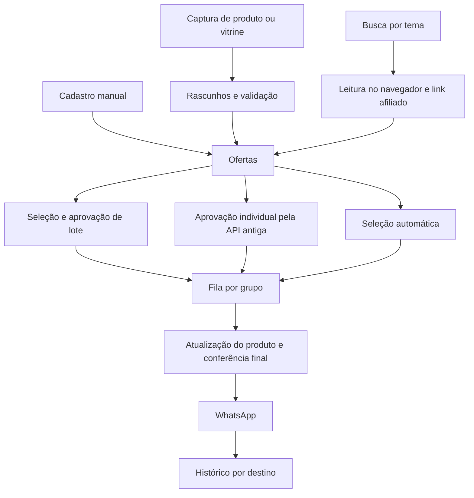
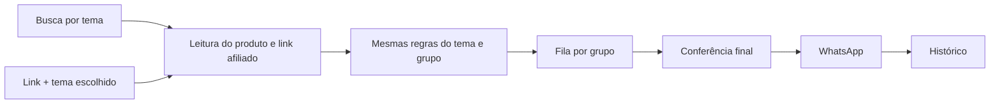

# Offer: fluxo atual e simplificação proposta

Revisão estática de 02/11/2026. Nesta etapa não foram alterados os fontes do aplicativo, o banco, a configuração ou o processo em execução. Foram examinados os módulos operacionais de `src/`, painel, estilos, extensão, scripts e inicializadores, além das referências e cenários de testes relacionados. Não houve teste de envio real.

## O produto que vamos manter

Decisões confirmadas pelo usuário:

- Pesquisa e envio automáticos, com inclusão pontual por link.
- Mercado Livre, Amazon e Shopee.
- Ao adicionar um link, escolher um tema e aplicar as mesmas regras do automático, sem segunda aprovação.
- Um botão para iniciar ou pausar pesquisa e envios.

O objetivo é eliminar funções e caminhos desnecessários. Reduzir consultas, repartir arquivos ou compactar código não basta para caracterizar essa simplificação.

## Fluxo atual

### Configuração

O aplicativo abre SQLite, sessão WhatsApp, servidor local, rotina de pesquisa e executor da fila. O usuário conecta a extensão e o WhatsApp, valida cada loja, configura grupos com horários e intervalo e cadastra temas com palavras-chave, faixa de preço, lojas e grupos.

A execução depende de três controles independentes: `search_enabled`, `automatic_enabled` e `publication_paused`. Grupos também têm habilitação própria, destinos por tema e uma lista adicional de autorização do automático.

### Três entradas de produto

1. **Cadastro manual:** o usuário preenche produto, título, preço, imagem, link afiliado e confirmações. `Offers.manual()` cria ou edita a oferta. Um envio parcial exige regras próprias para reconfirmar dados sem alterar o conteúdo enviado.
2. **Captura pontual:** o popup da extensão lê um produto ou vitrine do Mercado Livre, envia um pacote no fragmento da URL e o painel pede confirmação de importação. O pacote vira um rascunho no SQLite. A validação automática desse rascunho abre novamente o produto e gera o link afiliado. Há também uma preparação antiga com link informado manualmente.
3. **Pesquisa automática:** a cada 30 minutos, o servidor cria trabalhos de busca por tema, palavra-chave e loja. A extensão obtém URLs, o servidor cria trabalhos de produto e a extensão lê cada produto e gera seu link afiliado. O resultado atualiza observações e ofertas.

### Três caminhos para a fila

- A interface seleciona ofertas e grupos, gera uma prévia de lote, grava um snapshot e token, e depois confirma o lote.
- A API antiga ainda permite aprovar uma oferta individual usando o grupo padrão salvo. O painel atual não chama essa rota.
- O agendador automático escolhe ofertas elegíveis e cria uma entrega por grupo, sem confirmação individual.

Os três caminhos criam entregas que usam os mesmos campos de mensagem, preço e metadados aprovados.

### Transporte

O executor consulta a fila a cada cinco segundos. Para produtos do navegador, solicita uma leitura atualizada à extensão e aguarda seu resultado. Depois verifica as regras atuais, congela o texto e preço da tentativa, envia ao WhatsApp e registra o resultado por grupo.

Uma falha anterior ao transporte pode receber nova tentativa. Uma falha após o início do transporte pode ser incerta e exige conferência do recebimento. Essa distinção precisa continuar.

## Onde a complexidade está concentrada

| Área | Evidência no código | Simplificação proposta |
| --- | --- | --- |
| Aprovação manual | `Platform.batchPreview()` e `approveBatch()`, a partir das linhas 213 e 277; seleção e `previewBatch()` no painel | Eliminar seleção, prévias de lote, tokens e confirmação. A fila passa a ser alimentada exclusivamente pelo fluxo automático. |
| Cadastro e preparação | A classe `Offers` reúne cadastro manual, captura, preparação, aprovação individual e mistura de fontes na listagem | Remover essas operações. A inclusão por link cria um trabalho de produto com tema e usa a leitura automática já existente. A classe deixa de ser necessária quando seus consumidores forem removidos. |
| Captura paralela | Popup, pacote no fragmento da URL, rascunhos e acompanhamento de resolução próprio | Remover o protocolo de captura pontual. O painel recebe URL e tema; a extensão continua responsável por ler o produto. |
| Estado da operação | Busca, automático e pausa podem ter combinações independentes | Substituir por um estado único de operação. Os grupos autorizados ficam definidos em um só lugar. |
| Listagem com duas interpretações | `Offers.list()` calcula estado e prontidão; `Platform.reviewItems()` transforma e recalcula por grupo | Remover a lista de revisão. A operação mostra trabalhos, fila, falhas e histórico, usando os estados reais de cada registro. |
| API individual antiga | `Offers.publish()` e `/api/whatsapp/destination` mantêm grupo padrão, token e validação adicionais | Retirar essas rotas e dependências depois de remover os consumidores de testes. Os destinos vêm dos temas e grupos habilitados. |
| Pontuação sem consumidor operacional | `scoreOffer()` é calculado e gravado em cadastro/edição, mas não é consultado pela seleção automática nem exibido pelo painel | Remover cálculo, pesos e gravações associados. Não apagar o histórico existente do banco. |
| Avaliador antigo sem chamada em produção | `evaluateCandidate()` e `historyMedian()` aparecem no módulo de regras e em testes, sem chamada pelo fluxo operacional | Remover funções e constantes exclusivas desse avaliador. Preservar regras atuais de repetição e horários. |
| Interface e estilos | Tela inicial orientada a “Revisar”, formulário completo, checkboxes, barra e diálogo de lote | Trocar o fluxo de revisão por operação e link. Remover seus componentes e seletores CSS, mantendo responsividade, foco e mensagens de erro. |

Há ainda rotas de consulta sobrepostas (`/api/view`, `/api/state`, `/api/platform`, `/api/offers` e drafts). Não se deve manter uma rota só porque algum teste antigo a chama. A remoção deve seguir os consumidores efetivos do produto simplificado, conservando os endpoints da ponte e de configuração necessários.

## Fluxo proposto

### Operação

A tela principal mostra conexão, estado da operação, inclusão por link e fila/histórico. O formulário de inclusão contém apenas URL do produto e tema. O usuário acompanha leitura, bloqueio por regra ou entrega, sem preencher preço, imagem, título ou link afiliado.

A leitura obtém os dados nas lojas. O tema determina palavras-chave, preço, lojas e destinos. Colar um link não contorna essas regras. Se o produto não se enquadrar, a tela informa o motivo e não cria um envio.

Há um único controle “Iniciar/Pausar”. Quando pausado, não são iniciadas novas buscas, leituras de produtos ou transportes. Um trabalho do navegador já em andamento pode terminar e registrar seus dados, mas não libera envio. Uma mensagem cujo transporte já começou termina com o resultado registrado. Testar explicitamente uma conexão continua disponível na configuração e não autoriza publicação.

### Código

- Manter Node.js, SQLite e JavaScript sem framework; não introduzir bibliotecas ou infraestrutura para esta mudança.
- Reutilizar os trabalhos de navegador para links e buscas. Ambos produzem a mesma observação de produto e passam pelo mesmo agendamento.
- Remover os caminhos antigos com seus handlers, consultas, estados de interface e testes exclusivos; não deixar funções desligadas atrás de flags.
- Manter a verificação antes da leitura e a conferência final antes do envio, compartilhando as regras. São momentos distintos, necessários para detectar mudanças durante operações assíncronas.
- Remover dependências da publicação em “grupo padrão”, origem manual, captura e lote. Manter snapshot do que será enviado e registro imutável do que foi enviado.
- Conservar os módulos que continuarem tendo responsabilidade real. Não repartir arquivos apenas para diminuir o tamanho visual de cada um.

### Dados existentes

Preservar sessão, ofertas antigas, mensagens enviadas e histórico de repetição. Não apagar tabelas ou colunas antigas só para reduzir o esquema. Elas podem ficar sem uso pelo fluxo novo.

Na transição, entregas pendentes dos fluxos manuais retirados devem ser canceladas com motivo explícito. Entregas incertas não podem ser convertidas em novas tentativas. A nova autorização por grupo deve preservar a interseção entre grupos habilitados e os já autorizados para automático, sem ampliar destinos.

O estado inicial da operação deve conservar a condição mais restritiva dos controles anteriores: só fica ativo se automático e busca estavam habilitados e os envios estavam liberados. Instalação nova começa pausada. Após a transição, apenas o novo controle determina início e pausa.

## O que não é excesso a ser apagado

- Identidade do anúncio, vendedor, variante, preço total, estoque e link afiliado.
- Parser específico do Mercado Livre e adaptadores das outras duas lojas, mantidas por decisão do usuário.
- Autenticação da extensão, limites de mensagens HTTP e validação de origem.
- Persistência de trabalhos e entregas, idempotência de resultados e bloqueio de duas instâncias.
- Horários, intervalos, repetição por grupo e conferência de envios incertos.
- Fila de leitura do navegador e fila de publicação: representam trabalhos diferentes e precisam de recuperação diferente.

`extension/capture.js` é gerado de fontes compartilhados. Não representa duas implementações mantidas manualmente. Funções enviadas por `chrome.scripting.executeScript({func})` executam sem o escopo externo; extrair seus pequenos helpers exige respeitar essa limitação, em vez de remover repetições mecanicamente.

## Ordem da simplificação e validação

1. Implementar URL + tema sobre o trabalho de produto existente e demonstrar que tem os mesmos bloqueios do automático nas três lojas.
2. Unificar início/pausa e autorização de grupos; verificar que pausa impede novas leituras e novos transportes mesmo durante uma atualização de produto.
3. Substituir revisão por acompanhamento operacional e remover cadastro, captura, lote, aprovação individual e rotas exclusivas. Adaptar a extensão para sua função de leitura e pareamento.
4. Remover pontuação e avaliador sem uso, dependências de origem antiga e estados de interface que perderam seus consumidores. Limpar CSS e scripts de distribuição dos arquivos retirados.
5. Verificar migração em cópia de banco, backend, interface e pacote. Usar transportes fictícios nos testes; esta revisão não pede um envio real.

Cenários que precisam continuar cobertos: produto/variante corretos; preço ou condição alterados; falta de estoque; loja desconectada; produto fora do tema; pausa durante leitura; janela e intervalo por grupo; dois temas encontrando o mesmo produto; retomada após reinício; envio parcial por destino; resultado incerto; confirmação repetida da extensão; histórico anterior preservado.

Os testes de cadastro e aprovação retirados devem sair junto com esses recursos, depois de preservar a cobertura das regras compartilhadas. O número total de testes não é critério de sucesso.

## Como avaliar se ficou simples

- Duas entradas — tema e link — convergem para um único processamento.
- Há um único caminho de agendamento e um único controle de operação.
- Não existem formulários, tokens, snapshots de lote, rotas ou estados de cadastro manual ativos.
- O estado mostrado pela interface vem do trabalho ou entrega correspondente, sem duas listas reconstruindo a mesma situação.
- A comparação de fontes antes/depois usa a mesma formatação, separa código gerado de código mantido e mostra a redução líquida junto com os caminhos eliminados.

Não foi estimada uma porcentagem de redução de linhas: isso só pode ser demonstrado depois da remoção efetiva. A redução vem de funcionalidades e dependências que deixam de existir, e não de reformatar ou transferir código para outros arquivos.
